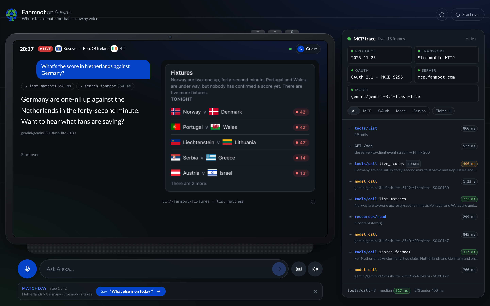
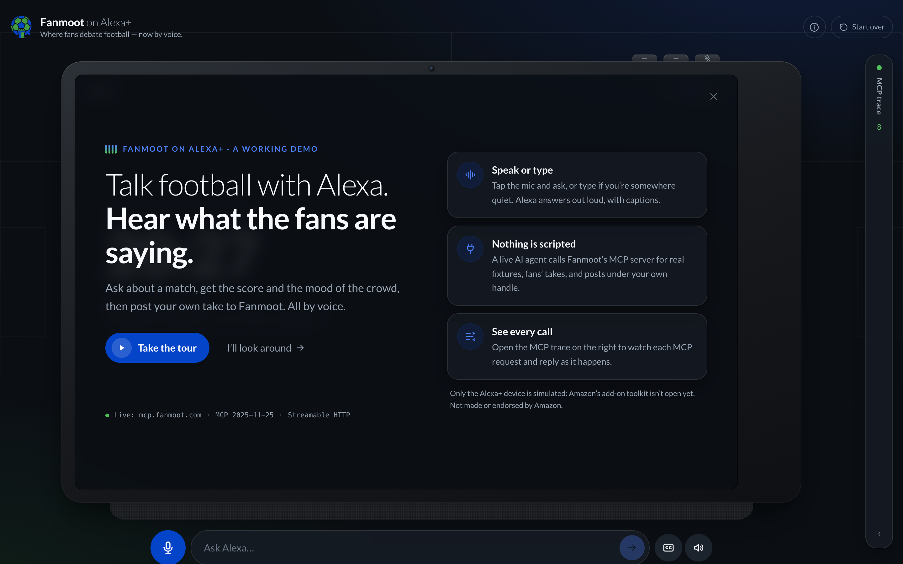
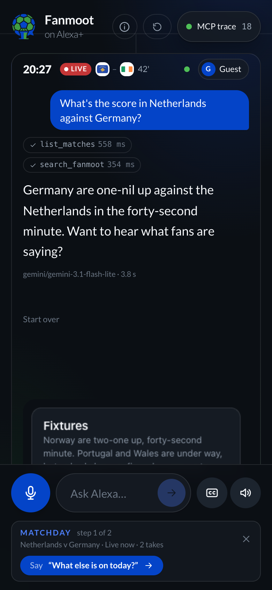
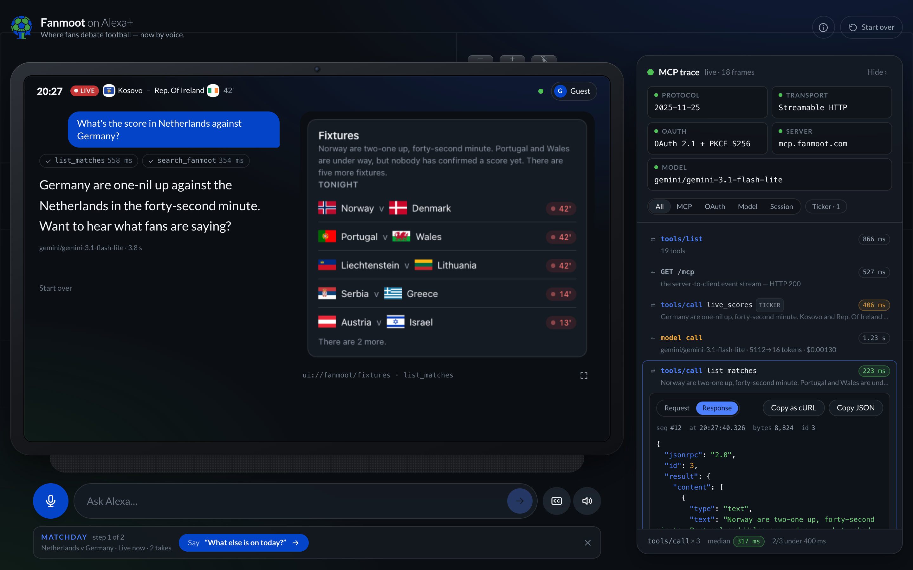
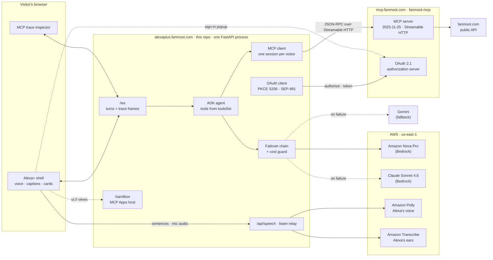

# Fanmoot on Alexa+

**Where fans debate football — now by voice.**

A web simulation of Fanmoot running as an Alexa+ experience, live at
**`https://alexaplus.fanmoot.com`**. You ask about a match, and an agent answers
by calling the real [Fanmoot MCP server](https://mcp.fanmoot.com/mcp). A trace
beside the conversation shows every MCP frame, OAuth request and model call as
it happens.

A real ADK agent, with Amazon Bedrock first, drives a real MCP session against
`mcp.fanmoot.com` and signs fans in through a real OAuth 2.1 flow. Only the
Alexa+ device is simulated.

## Try it

**The fastest way is the live demo, with nothing to install:
[alexaplus.fanmoot.com](https://alexaplus.fanmoot.com).** Press **Take the
tour**, or ask *"what's happening in the Premier League today?"*, and open the
trace to watch each MCP call.

### Run it on your own machine

You need **Docker** and **one model key**. Either key works:

- a free **Gemini** key from [Google AI Studio](https://aistudio.google.com/apikey), or
- **AWS** keys with Amazon Bedrock access to Nova Pro in `us-east-1`.
  These also turn on Polly (voice) and Transcribe (listening).

**1. Get the code and add your key.**

```bash
git clone https://github.com/iyinusa/fanmoot-alexa-plus-demo.git
cd fanmoot-alexa-plus-demo

echo "FMD_GEMINI_API_KEY=your-key" > .env
# or, for Bedrock:
# printf "FMD_AWS_ACCESS_KEY_ID=...\nFMD_AWS_SECRET_ACCESS_KEY=...\n" > .env
```

**2. Run it.**

```bash
docker compose -f docker-compose.local.yml up --build     # or: make local
```

The first build takes a few minutes, because it builds the web app inside
Docker, so you don't need Node or Python. It is ready when the log says
`Uvicorn running on http://0.0.0.0:8090`.

**3. Open [http://localhost:8090](http://localhost:8090)** in Chrome, Edge,
Firefox or Safari. Type or speak a question. To check the setup, open
[http://localhost:8090/healthz](http://localhost:8090/healthz). It lists each
model in the chain and whether it is `ready`, and shows that the MCP server is
reachable.

**4. Try posting.** Say or type *"tell them the second goal was offside"*.
Alexa shows a **Sign in to Fanmoot** button, and the sign-in popup is the MCP
server's own OAuth page. Sign in or create an account, and the take posts to
the real fanmoot.com under your own handle.

**5. Run the tests** (optional, needs [uv](https://docs.astral.sh/uv/) and
Node.js 22):

```bash
make install && make test     # offline: no network, no keys
```

| | With a Gemini key | With AWS Bedrock keys |
|---|---|---|
| Answers, cards, trace, sign-in and posting | Yes | Yes |
| Model that answers | Gemini | Amazon Nova Pro, then Claude on Bedrock |
| Alexa's voice and listening | Your browser's built-in speech | Amazon Polly and Amazon Transcribe |

With no key at all, the demo still opens and connects to the MCP server, and
each answer explains that no model could reply.

Deployment steps are in [`docs/runbook.md`](docs/runbook.md).



<table>
<tr>
<td width="62%"></td>
<td width="38%"></td>
</tr>
<tr>
<td colspan="2"></td>
</tr>
</table>

*These were taken against a local build answering
with Gemini; the deployment answers with Amazon Nova Pro on Bedrock first.*

## Why a simulation

The Alexa+ Add-on toolkit is partner-gated. **The simulation is
only the surface.** The MCP server it calls is real, deployed, and connectable
from Claude, ChatGPT or any other MCP client today. The agent's answers are
real model output, not a script.

This project is not affiliated with, endorsed by or certified by Amazon.

## How it is built



The browser holds no credential: it speaks only `/ws`. Every model call, MCP
request and OAuth request is made by this server, and each one is copied,
redacted, onto the trace the visitor sees.

- **The tools come from the server.** Each turn, the agent is given exactly
  the tools `tools/list` returned, with the server's own descriptions and JSON
  Schemas. Nothing about a tool is written in this repository, so the demo
  cannot drift from the server.
- **One real MCP session per visitor**, with the official `mcp` client SDK,
  negotiating protocol `2025-11-25`. When the server refuses a call with a 401
  challenge, the visitor gets a "Sign in to Fanmoot" button.
- **A switchable model chain.** `FMD_MODEL_CHAIN` lists models in the order
  they are tried, and no provider is preferred over another: put Gemini first
  and Gemini answers. The default, when it is unset, is Amazon Nova Pro on
  Bedrock, then Claude on Bedrock, then Gemini. A provider that errors,
  throttles or times out falls through to the next one for that model call. The chain is read every turn and can be reordered on a running
  demo (see [Operator API](#operator-api)). Every call's tokens and estimated
  cost are counted per provider, with optional daily ceilings.
- **A real sign-in.** "Sign in to Fanmoot" opens the MCP server's own
  `/authorize` in a popup. The demo discovers the authorization server
  (RFC 9728, RFC 8414), sends PKCE S256, `state` and a `resource` indicator,
  checks `iss` on the way back, and redeems the code on the server. The browser
  never sees a token.
- **The browser holds nothing sensitive.** Model credentials, the MCP session
  and any grant stay in this process. The browser gets turns and trace frames
  over `/ws`, with tokens and email addresses struck out before they are sent.
- **The cards are the server's own.** When a tool has a view, the demo reads
  the `ui://` resource over MCP and runs it as an MCP Apps host would
  (`2026-01-26`). The view runs in `/sandbox`, a proxy framed without
  `allow-same-origin`, so it gets an opaque origin of its own. Inside it, a CSP
  built from the resource's declared domains applies. The thread card's reply
  box calls `reply_to_moot` through the host bridge, on the visitor's own MCP
  session and grant.
- **Alexa's voice is Amazon Polly; her ears are Amazon Transcribe.** Answers
  are spoken sentence by sentence as they stream, in Polly's generative
  British voice (Amy), each sentence fetched from `/api/speech` while the one
  before it plays. The fan's voice is recorded with an AudioWorklet — which
  Chrome, Edge, Firefox, Safari and Brave all have — and streamed as 16 kHz PCM
  up `/ws`; the server relays it to Transcribe's streaming API over a
  WebSocket it signs itself (SigV4), and the words come back as they are
  heard. The browser decides when the fan has stopped, from the audio's level
  and from the words settling. Nothing is installed in the browser and no key
  reaches it. Where AWS says no (no permission, a ceiling reached), the
  browser's own Web Speech API takes over, and the typed field is always
  there. The waveform draws the real spectrum of whoever is talking, and the
  captions follow the audio's own clock.
- **The trace inspector.** The column beside the device (a sheet on a phone)
  opens with five facts, each read from the live session: the protocol
  version `initialize` negotiated, the transport and its `Mcp-Session-Id`, the
  PKCE method the authorization server advertises (or the grant the session
  holds), the server's `serverInfo`, and the model that answered last. Below
  them, each request and its response are one row, with direction, status and
  round trip. Tool calls are graded against a 400 ms budget. Open a row for the
  pretty-printed JSON-RPC payload. **Copy as cURL** gives a script that opens
  its own session on `mcp.fanmoot.com` and sends the same request, so anything
  on the trace can be reproduced from a terminal.
- **Live scores before anyone speaks.** While a visitor is connected, their
  session calls `live_scores` on a timer. With nothing in play it calls
  `upcoming_matches` instead. These calls appear on the trace marked
  `ambient`, and calls made by a card are marked `view`.
- **A first screen that explains itself.** A first visit opens on the
  device's own welcome screen: what the demo is, that everything but the
  device is real (with the live connection to `mcp.fanmoot.com` shown under
  it), and where the trace is. "Take the tour" starts the first guided
  scenario as a real turn. The ⓘ button in the header brings the screen back.
- **Failure in the device's own voice.** A turn that fails is answered with an
  apology Alexa says out loud, and the error code sits in small print under
  it. Offline, disconnected, out of date, timed out or full, the device shows
  a screen of its own, with the light pulsing amber, a countdown and a way on.
  A render error shows a restart screen, never a blank page.
- **Keyboard and screen reader.** Everything is reachable by Tab, with a skip
  link first and `/` to jump to the question box. Tabs take arrow keys, the
  trace sheet keeps focus inside it and returns it on close, and each finished
  answer is announced once rather than word by word. Captions are on by
  default. Reduced motion stops every animation, including the waveform and
  the light.
- **Fast on a phone, and kept that way.** The bundle is gzipped on the way
  out. The trace inspector, the cards and Framer Motion's layout and drag
  features load after the first paint. A Vite plugin (`web/budget.ts`) fails
  any build whose critical-path JavaScript goes over 100 KB gzipped, or any
  chunk over 60 KB: on a laptop, in CI and in the Docker image alike.
- **A link that looks deliberate.** Open Graph and X card tags, with the
  image's absolute URL written from `FMD_PUBLIC_BASE_URL` as the page is
  served, so staging previews point at staging. `make share-image` redraws
  the 1200 × 630 image from an HTML template in the brand's own colours and
  fonts, using headless Chrome.
- **One image, two stages.** A Node stage builds the React app, and a Python
  stage serves it with the agent from one FastAPI process. One origin, one
  route, no CORS.
- **Brand from the source.** The Floodlit design tokens and the Lato font files
  are copied unchanged from `fanmoot/web`, and `make brand-check` fails if they
  drift.

## Running it

For a quick local run, use [Try it](#try-it) above. This
section is for development, with Python 3.12, uv and Node.js 22 on the host.

```bash
make install && cp .env.example .env
# Add model credentials to .env: FMD_AWS_* for Bedrock, FMD_GEMINI_API_KEY for Gemini.
make build-web          # the SPA → app/static/web
make dev                # http://localhost:8090
```

Without model credentials the demo still starts and connects to the MCP
server. Each turn then ends with a clear "no model could answer" message, and
the trace shows which models were skipped and why.

For frontend work, run `make dev` and `make dev-web` side by side. Vite serves
on `:5174` with hot reload and proxies `/ws`, `/oauth` and `/healthz` to `:8090`.

Deploying to Dokploy, checking it and keeping its costs down are in
[`docs/runbook.md`](docs/runbook.md).

In Docker, the same stack Dokploy runs:

```bash
make up                 # http://localhost:8090
```

| Command | What it does |
|---|---|
| `make check` | Everything CI runs: ruff, `mypy --strict`, `tsc -b`, pytest |
| `make test-live` | The multi-turn scenario against the deployed MCP server. Add `FMD_LIVE_MODEL=1` for a real-model run |
| `make evidence` | A Bedrock-only run of that scenario, saved to `evidence/` |
| `make turn-cost` | What a turn costs: a real-model run of that scenario, priced for every model in the chain |
| `make smoke` | Check the deployment from outside: TLS, health, page, OAuth client, `/ws`, cost guard |
| `make load-check` | Twenty visitors at once, each holding an MCP session, with latency and memory |
| `make screenshots` | Retake `docs/screenshots/` with headless Chrome (asks one real question) |
| `make build-web` | Build the SPA into `app/static/web`. Fails if the JavaScript is over budget |
| `make bundle-budget` | Build, and print the gzipped JavaScript against its budget |
| `make share-image` | Redraw the link-preview image, `web/public/share/og.png`, with headless Chrome |
| `make brand-check` | Diff the Floodlit tokens and fonts against a sibling `fanmoot` checkout |
| `make help` | Every target |

### Tests

`make test` runs offline. It starts a real Streamable HTTP MCP server on a
loopback port (built with the SDK's own FastMCP, with a 401/403 gate like the
real server's), fakes the authorization server at the HTTP layer, and scripts
the model. The agent, the failover chain, the MCP client, the OAuth client and
ADK all run for real.

`make test-live` drives five turns against `https://mcp.fanmoot.com/mcp` and
checks the tool calls in order, the `2025-11-25` handshake, and that an
unauthenticated post is refused with a 401 challenge. Nothing is posted.

## Configuration

Every setting is an environment variable with the `FMD_` prefix. See
[`.env.example`](.env.example) for all of them. The ones you are most likely to
set:

| Variable | Default | Meaning |
|---|---|---|
| `FMD_PUBLIC_BASE_URL` | `http://localhost:8090` | This demo's origin. `/ws` accepts it, and the OAuth redirect URI is built from it |
| `FMD_MCP_URL` | `https://mcp.fanmoot.com/mcp` | The MCP server the demo drives |
| `FMD_MODEL_CHAIN` | Nova Pro, Claude, Gemini | LiteLLM model ids, tried in the order given. `bedrock/…` and `gemini/…` prefixes are added to bare Bedrock and Gemini ids (`gemini-3.1-flash-lite` → `gemini/gemini-3.1-flash-lite`) |
| `FMD_AWS_REGION` | `us-east-1` | Bedrock region. Enable each model in the Bedrock console for it |
| `FMD_AWS_ACCESS_KEY_ID` / `_SECRET_ACCESS_KEY` | *(empty)* | Bedrock keys. Empty means the standard AWS credential chain |
| `FMD_GEMINI_API_KEY` | *(empty)* | Google AI Studio key. Empty skips the Gemini rung |
| `FMD_PROVIDER_DAILY_CAP_USD` | `{"bedrock": 30, "gemini": 10, "polly": 4, "transcribe": 4}` | Daily spend ceiling per provider. Over it, the chain skips that provider, and Polly or Transcribe hand voice back to the browser. `{}` turns it off |
| `FMD_DAILY_CAP_USD` | `40` | Daily spend ceiling for the whole demo. Over it, turns are refused until 00:00 UTC |
| `FMD_DAILY_TURN_CAP` | `2000` | Turns per UTC day, whatever they cost |
| `FMD_ADDRESS_TURNS_PER_HOUR` | `60` | Turns one client address may start in any hour, across reloads |
| `FMD_SESSION_TURN_CAP` | `40` | Turns one session may take |
| `FMD_OAUTH_CLIENT_MODE` | `auto` | How the demo identifies itself to the authorization server. See below |
| `FMD_VOICE_ENABLED` | `true` | Speak with Amazon Polly and listen with Amazon Transcribe. `false` leaves voice to each browser's Web Speech API |
| `FMD_VOICE_ID` / `_ENGINE` | `Amy` / `generative` | The Polly voice. A voice or region without the generative engine falls back to `neural` by itself |
| `FMD_VOICE_CHARS_PER_SESSION` | `15000` | Characters Polly may speak for one session, about 40 answers |
| `FMD_LISTEN_SECONDS_PER_SESSION` | `600` | Seconds of the fan's voice Transcribe may hear in one session |
| `FMD_ADMIN_TOKEN` | *(empty)* | Bearer token for `/api/admin/models`. Empty disables it |
| `FMD_AMBIENT_INTERVAL_S` | `30` | Seconds between the ticker's `live_scores` calls. `0` turns the ticker off |
| `FMD_GUIDE_TTL_S` | `300` | Seconds the guided scenarios' reading of what is on is kept. `0` uses fixed phrases |
| `FMD_GUIDE_COMPETITIONS` | Premier League, … | Competitions a scenario prefers, most preferred first |

### How the demo signs in as a client

With `FMD_OAUTH_CLIENT_MODE=auto`:

- On an `https` deployment, the demo uses a **client ID metadata document**
  (SEP-991, recommended by the `2025-11-25` spec). Its `client_id` is the URL
  of `/oauth/client-metadata.json`, which it serves itself. Nothing needs
  registering and there is no secret.
- On `http://localhost`, the authorization server cannot fetch that document,
  so the demo registers itself with **Dynamic Client Registration** (RFC 7591),
  once per process.
- With `FMD_OAUTH_CLIENT_ID` set, it uses that **static client**.

### Accounts

There is no shared demo account. Reading needs no account at all. To post, a
visitor signs in to Fanmoot, or creates an account on the spot, on
Fanmoot's own page in a popup, and everything they post goes out under their
own handle.

## Endpoints

| Path | |
|---|---|
| `/` | The demo SPA, with client-side routing fallback |
| `/ws` | The conversation and trace channel ([protocol](app/ws.py)) |
| `/oauth/start` | Opened by the sign-in popup. Starts a PKCE authorization and redirects to the MCP server's `/authorize` |
| `/oauth/callback` | Where the fan returns. The code is redeemed here, server-side |
| `/oauth/client-metadata.json` | This demo's OAuth client metadata (SEP-991) |
| `/api/speech` | `POST` one sentence, get it back as MP3 from Amazon Polly. Only a live session may ask, identified by its id and resume token |
| `/linked` | The popup's last page. Tells the opener and closes |
| `/sandbox` | The MCP Apps sandbox proxy the server's `ui://` views run in. Only this origin may frame it |
| `/api/admin/models` | The model chain, today's spend and turns against the ceilings, and memory. Needs `FMD_ADMIN_TOKEN` |
| `/healthz` | Always 200. Reports the build, the MCP server's reachability and protocol version, the model chain and whether the SPA is built |

## Operator API

Read the chain and today's usage per provider:

```bash
curl -H "Authorization: Bearer $FMD_ADMIN_TOKEN" https://alexaplus.fanmoot.com/api/admin/models
```

Put Gemini first, from the next turn on, without a redeploy:

```bash
curl -X PUT -H "Authorization: Bearer $FMD_ADMIN_TOKEN" -H "Content-Type: application/json" \
  -d '{"chain": ["gemini/gemini-3.1-flash-lite", "bedrock/us.amazon.nova-pro-v1:0"]}' \
  https://alexaplus.fanmoot.com/api/admin/models
```

`DELETE` on the same URL goes back to `FMD_MODEL_CHAIN`. The override is held in
memory, so a restart also goes back to it.

## Built on AWS

The demo's agent runs on **Amazon Bedrock** in `us-east-1`. The default
model chain is **Amazon Nova Pro** first, then **Claude Sonnet 4.6 on
Bedrock**, then Gemini as a peer from another provider, so a Bedrock outage
degrades the demo rather than stopping it.

- **Bedrock is called, not just named.** Every turn records the Bedrock model
  id that answered. It is in the `turn.end` frame the browser receives, on the
  trace's model card, in the `turn_complete` log line, and in each model-call
  row with its tokens and estimated cost.
- **Through ADK and LiteLLM.** Google's Agent Development Kit runs the agent
  loop. LiteLLM is its Bedrock adapter, given the credentials directly rather
  than through the process environment, and set to no retries, because
  failover (`app/agent/models.py`) is this repository's job. A rung that
  errors, throttles or times out passes the call to the next rung. The switch
  is shown on the trace. A call that has already streamed words is never
  retried, so a fan never hears an answer twice.
- **Cross-region inference profiles** (`us.amazon.nova-pro-v1:0`,
  `us.anthropic.claude-sonnet-4-6`), which is how Bedrock serves on-demand
  calls for these models. The IAM policy the deployment uses allows
  `InvokeModel` on those two alone ([runbook](docs/runbook.md#0-before-you-start)).
- **Cost measured, then capped.** `make turn-cost` runs the standing
  conversation with a real model and prices the tokens for each model in the
  chain. On 2026-09-24 a turn was 11–17k tokens in, costing about **$0.011 on
  Nova Pro** and $0.044 on Claude Sonnet. The ceilings are set from those
  numbers: 40 turns a session, 60 an hour per address, $30 a day on Bedrock
  and $40 a day in all, each checked before every model call. Today's spend
  per provider is on `GET /api/admin/models`. Past a ceiling the device says
  so in Alexa's voice, and it never shows an error.
- **Switchable on numbers, live.** `PUT /api/admin/models` reorders the chain
  from the next turn, with no redeploy. "Bedrock got expensive, switch to
  Gemini" becomes a decision taken from that day's figures.
- **Polly and Transcribe are the voice.** Every spoken answer is Amazon Polly
  (generative engine, neural behind it), and every spoken question is heard
  by Amazon Transcribe streaming. Both are priced into the same ledger
  (`polly`, `transcribe`) and capped per day and per session like the models
  (`app/voice/`).
- **The MCP server uses Bedrock too.** `match_mood` on `mcp.fanmoot.com`
  reads the mood of a match thread with Amazon Nova Lite, cached per thread.

**Standing evidence.** `make evidence` runs the five-turn matchday
conversation against the live MCP server with the chain cut to Bedrock only.
It writes the full frame transcript and a summary (the Bedrock model that
answered each turn, its tokens, estimated cost and the tools it called) to
[`evidence/`](evidence/). It refuses to write anything if any turn was
answered by a model that is not on Bedrock.

## Licence and third-party notices

**The code is MIT-licensed.** See [LICENSE](LICENSE). You may use, copy,
change and share it, including commercially, as long as the licence notice
stays with it.

The MIT licence covers the code in this repository only. It does not cover
the following, which belong to others:

- **Club crests.** The cards show club crests served by fanmoot.com, **only to
  identify the clubs in a fixture or the club a fan supports**. Fanmoot gets
  them through the official logo endpoint of
  [API-Football](https://www.api-football.com/) (api-sports.io), whose terms
  provide logos to API customers and recommend storing them rather than
  hotlinking. API-Sports claims no rights in the logos. Crests are trademarks
  of their clubs and leagues, and Fanmoot claims no ownership of any of them.
  Every club also has a monogram badge generated by Fanmoot, and any crest is
  replaced by its monogram on request from its rights holder. No crest is
  stored in this repository.
- **Names.** Club, player and competition names are used only to identify
  them.
- **Alexa and Alexa+** are trademarks of Amazon.com, Inc. The device surface
  here is Fanmoot's own design and uses no Amazon assets.
- **Fans' posts** are their authors' own, shown under Fanmoot's terms.
- **The Fanmoot name, logo and Floodlit brand** are Fanmoot's own marks. They
  are included so the demo renders correctly, and are not covered by the MIT
  licence.
- **Lato**, the typeface, is used under the
  [SIL Open Font License 1.1](https://openfontlicense.org).

This project is not affiliated with, endorsed by or certified by Amazon, any
club or any league.
